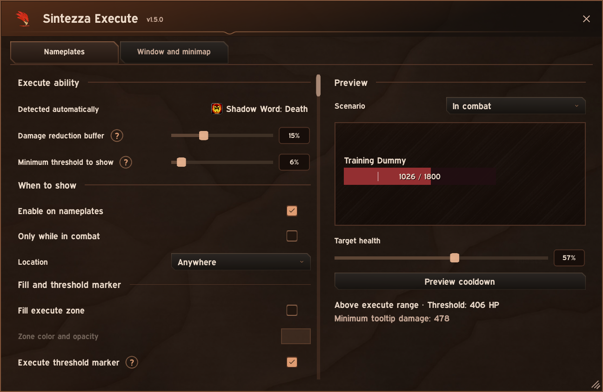
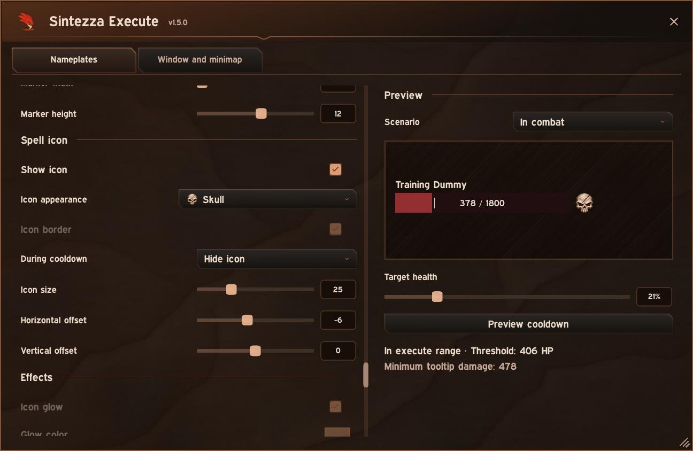
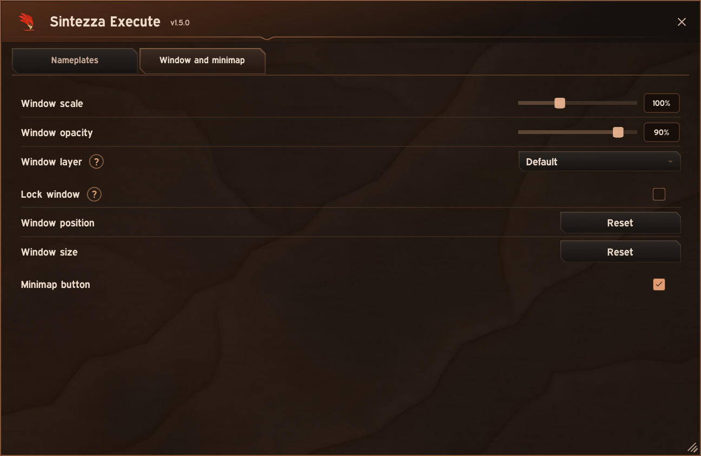

# Sintezza Execute

| CurseForge field | Value |
| --- | --- |
| Game | World of Warcraft |
| Class | Addons |
| Flavor and version | Forever 1.60.1 |
| Main category | Combat |
| Additional categories | Priest, Warrior, Paladin, Warlock |
| CurseForge relations | Sintezza Theme (Required Dependency) |
| Project license | MIT. See the repository for third-party notices. |

## Summary

Enemy nameplate execute thresholds for Priest, Warrior, Paladin, and Warlock in WoW Forever.

## Description

See the health threshold for your execute ability on enemy nameplates in WoW Forever. Sintezza Execute detects your highest learned rank and marks the point where the target enters execute range.

### Read the execute threshold

The preview shows the 406 HP Shadow Word: Death threshold while the dummy is at 57% health.

Shadow Word: Death uses the minimum damage shown in your tooltip and a configurable damage buffer. Warrior Execute and Paladin Hammer of Wrath use 20% health or less. Warlocks with Soul Fire and Decimation learned get a marker below 35% health. Normal casting requirements still apply.

### Preview the icon and cooldown

At 21% health, the dummy is below the threshold and the selected skull icon appears.

Enable the shaded execute zone, threshold marker, and icon independently. Pick the spell icon or a custom icon, then use the built-in preview to test different health, combat, and cooldown states. You can limit the indicator to combat or choose where it appears.

### Window and minimap

Open settings with `/sexecute`, the minimap button, or the WoW AddOns menu. The **Window and minimap** tab controls scale, opacity, and whether the minimap button is shown.

### Appearance

**Requires [Sintezza Theme](https://github.com/ArtefactoO/Sintezza_Theme).** Open `/stheme` to change the color scheme, button styles, background, and fonts across your Sintezza addons.

### Requirements

Works with Blizzard nameplates and [EllesmereUI Nameplates](https://www.curseforge.com/wow/addons/ellesmereui). On first setup, Execute can reuse the threshold marker style from [Sintezza UI](https://github.com/ArtefactoO/Sintezza_UI).

<!-- Changelog field -->

### Changelog

[View the release history on GitHub](https://github.com/ArtefactoO/Sintezza_Execute/blob/main/CHANGELOG.md).

Source, installation details, and credits are available on [GitHub](https://github.com/ArtefactoO/Sintezza_Execute).
