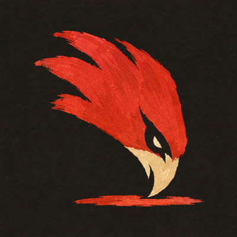
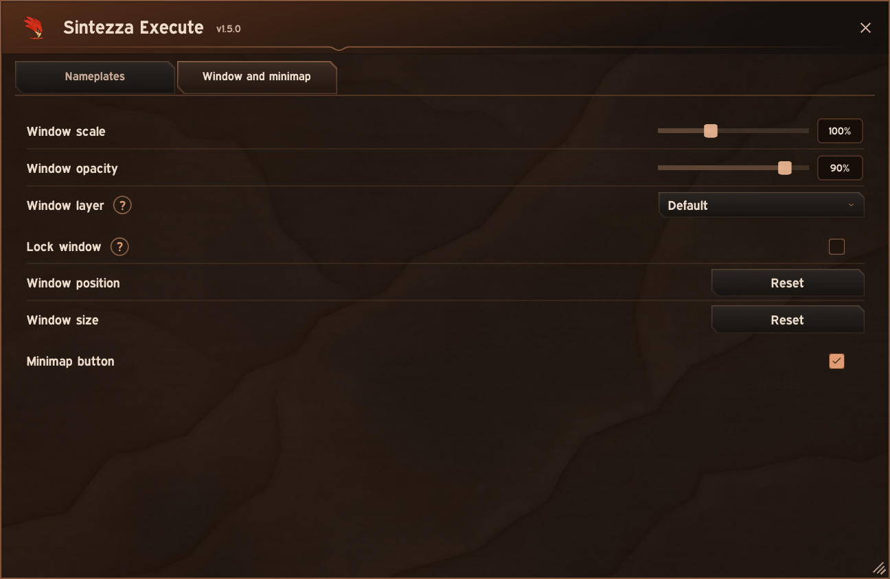

# Sintezza Execute

Sintezza Execute automatically finds your highest learned rank of a supported execute ability in World of Warcraft Forever 1.60.1. Enable the fill, threshold marker, and icon on enemy nameplates independently. The icon uses the ability's texture by default, and **Icon appearance** offers six transparent alternatives.

Install and enable **[Sintezza Theme](https://github.com/ArtefactoO/Sintezza_Theme)** alongside Execute. The indicator supports Blizzard and EllesmereUI nameplates. Enable a single execute indicator if you also have Shadowpriest: Execute installed. On first setup, Execute can reuse the threshold marker style from the active **Sintezza UI** profile.

## How it works

- **Priest · Shadow Word: Death.** The threshold uses the tooltip's minimum damage and your damage buffer. A tooltip range of 600–750 with a 10% buffer gives a threshold of 540 HP, before target effects such as shields and damage reduction. If the damage range cannot be read, the settings show a message and the live threshold is unavailable.
- **Warrior · Execute** and **Paladin · Hammer of Wrath.** The marker shows the health requirement of 20% or less. Casting still depends on resources, range and any other ability requirements.
- **Warlock · Soul Fire with Decimation.** The marker shows the phase below 35% when both the spell and the talent are learned. The talent effect still needs to trigger to empower Soul Fire.

**Minimum threshold to show** filters the Shadow Word: Death indicator by the size of the execute zone as a share of maximum health. Set it to 0% to turn it off. Combat and location settings can limit where the indicator appears. The preview uses the character's detected ability and lets you change target health, simulate cooldown where applicable, and switch between combat scenarios.

## Open settings

Use `/sexecute`, the minimap button, or the in-game AddOns settings category. **Nameplates** shows the detected ability and groups the threshold, display conditions, fill, marker, and icon settings in a single scrollable column. The live preview stays in view on the right. **Window and minimap** contains shared window controls and the minimap button toggle.

The display language follows Sintezza Theme. The tooltip language follows the game client. The legacy commands `/spx`, `/spexecute`, and `/tods` are available when Shadowpriest: Execute is disabled.

## Gallery

The preview shows the 406 HP Shadow Word: Death threshold while the dummy is at 57% health.

At 21% health, the dummy is below the threshold and the selected skull icon appears.

The Window and minimap tab groups scale, opacity, layer, position, size, and the minimap button.

## License and credits

Inspired by [Shadowpriest: Execute](https://www.curseforge.com/wow/addons/shadowpriest-execute) and [Does It Die](https://github.com/swirllyman/DoesItDie). [MIT License and code credits](LICENSE.txt) · [Changelog](CHANGELOG.md)

[CurseForge listing fields](CURSEFORGE.md)
