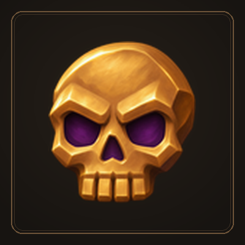
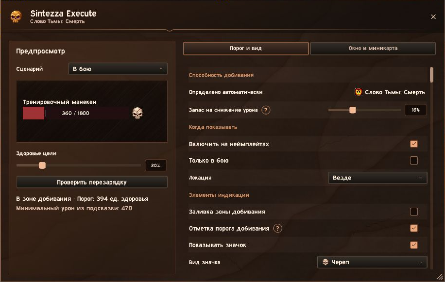
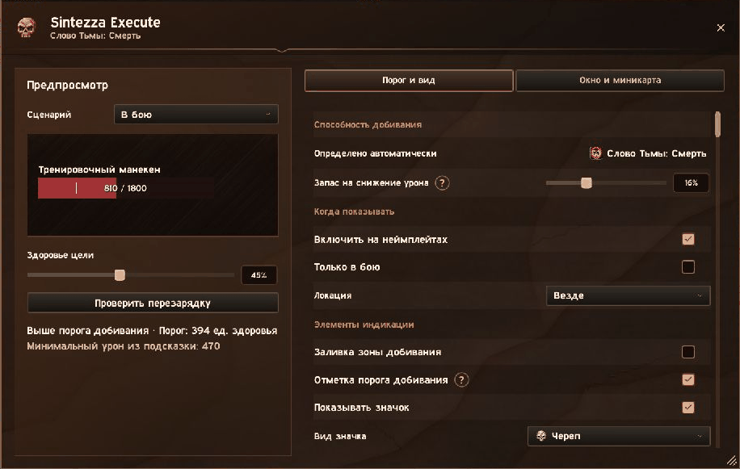

# Sintezza Execute

Sintezza Execute automatically finds your highest learned rank of a supported execute ability in World of Warcraft Forever 1.60.1. Enable the fill, threshold marker, and icon on enemy nameplates independently. The icon uses the ability's texture by default, and **Icon appearance** offers six transparent alternatives.

Install and enable **[Sintezza Theme](https://github.com/ArtefactoO/Sintezza_Theme)** alongside Execute. The indicator supports Blizzard and EllesmereUI nameplates. Enable a single execute indicator if you also have Shadowpriest: Execute installed. Execute can import the indicator appearance from the active **Sintezza UI** profile when that optional addon is enabled.

## How it works

- **Priest · Shadow Word: Death.** The threshold uses the tooltip's minimum damage and your damage buffer. A tooltip range of 600–750 with a 10% buffer gives a threshold of 540 HP, before target effects such as shields and damage reduction. If the damage range cannot be read, the settings show a message and the live threshold is unavailable.
- **Warrior · Execute** and **Paladin · Hammer of Wrath.** The marker shows the health requirement of 20% or less. Casting still depends on resources, range and any other ability requirements.
- **Warlock · Soul Fire with Decimation.** The marker shows the phase below 35% when both the spell and the talent are learned. The talent effect still needs to trigger to empower Soul Fire.

**Minimum threshold to show** filters the Shadow Word: Death indicator by the size of the execute zone as a share of maximum health. Set it to 0% to turn it off. Combat and location settings can limit where the indicator appears. The preview uses the character's detected ability and lets you change target health, simulate cooldown where applicable, and switch between combat scenarios.

## Open settings

Use `/sexecute`, the minimap button, or the in-game AddOns settings category. The **Threshold and appearance** tab controls the buffer and the three indicator elements. **Advanced** covers size, color, the minimum health percentage, cooldown behavior, and pulse. **Window and minimap** contains shared window controls and the minimap button toggle.

The display language follows Sintezza Theme. The tooltip language follows the game client. The legacy commands `/spx`, `/spexecute`, and `/tods` are available when the upstream addon is disabled.

## Gallery

## License and credits

Sintezza Execute is distributed under the MIT license. Rank selection and threshold calculation adapt code from Shadowpriest: Execute 0.11.4 by goerkel. Nameplate rendering and parts of the options adapt code from Does It Die by Joe Greive. Sintezza adds independent indicator controls, a preview, and shared theme integration. [MIT license](LICENSE.txt) · [Shadowpriest: Execute 0.11.4](https://www.curseforge.com/wow/addons/shadowpriest-execute/files/9580243) · [Does It Die](https://github.com/swirllyman/DoesItDie) · [Changelog](CHANGELOG.md)

## На русском

Sintezza Execute автоматически находит изученную способность добивания и показывает ее порог на полосках здоровья Blizzard и EllesmereUI в WoW Forever 1.60.1. Заливка, отметка порога и значок включаются отдельно. Для работы нужна **Sintezza Theme**. **Sintezza UI** можно подключить для импорта прежнего оформления из активного профиля.

- **Жрец · «Слово Тьмы: Смерть».** Порог рассчитывается по минимальному урону высшего изученного ранга с учетом запаса. При уроне 600–750 и запасе 10% порог составляет 540 HP до учета щитов и снижения урона. Если прочитать диапазон урона не удалось, настройки покажут сообщение, а порог на неймплейте будет недоступен. К этой способности применяется фильтр **«Мин. порог для показа»**.
- **Воин · «Казнь» и паладин · «Молот гнева».** Отметка показывает требование к здоровью цели, 20% и ниже. Для применения способности также учитываются ее обычные требования к ресурсам, дистанции и стойке.
- **Чернокнижник · «Огонь души» с Decimation.** При изученных способности и таланте отметка показывает фазу ниже 35%. Для усиления заклинания должен сработать эффект таланта.

`/sexecute`, кнопка у миникарты и категория модификаций открывают настройки. В списке **«Вид значка»** есть родная иконка способности («Авто») и шесть прозрачных вариантов. В предпросмотре можно менять здоровье цели, состояние перезарядки и боевой сценарий. В расширенных настройках доступны цвет, размер, пульсация и поведение значка на перезарядке. Язык интерфейса выбирается в `/stheme`.

Использованы адаптации кода Shadowpriest: Execute и Does It Die. [Лицензия MIT](LICENSE.txt) · [История изменений](CHANGELOG.md)

[CurseForge listing fields](CURSEFORGE.md)
